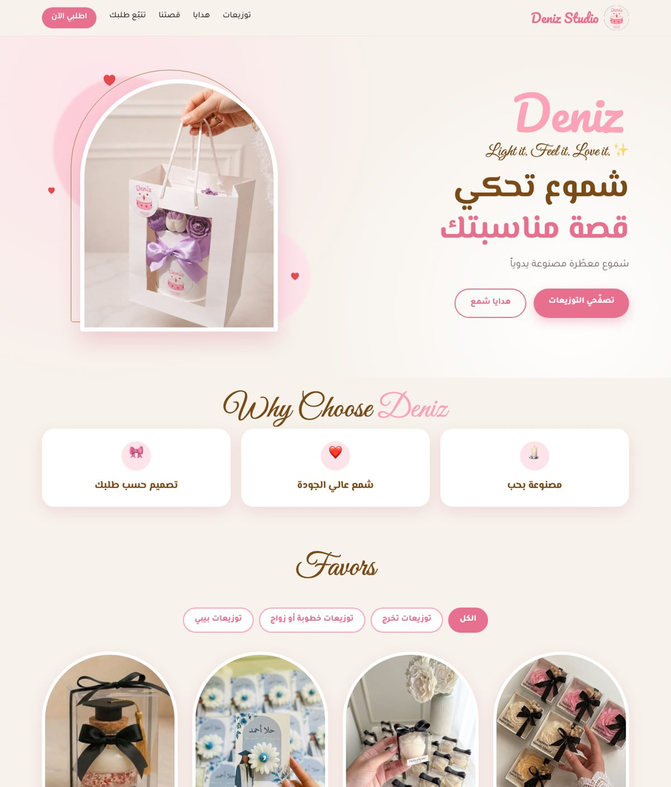
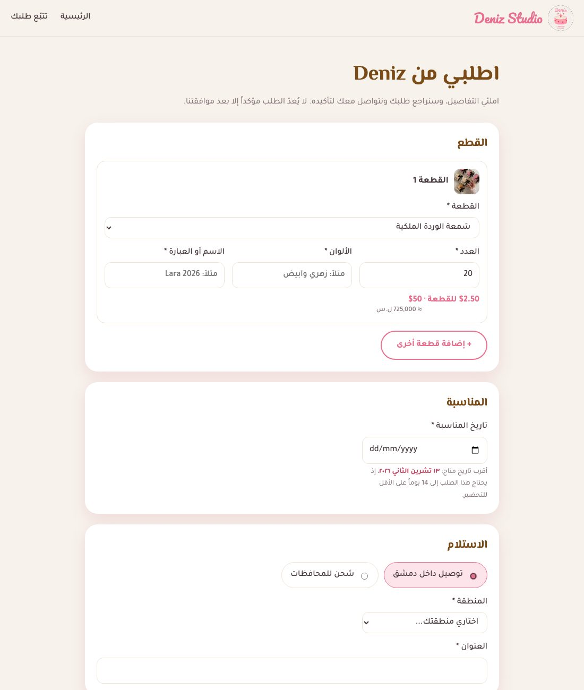
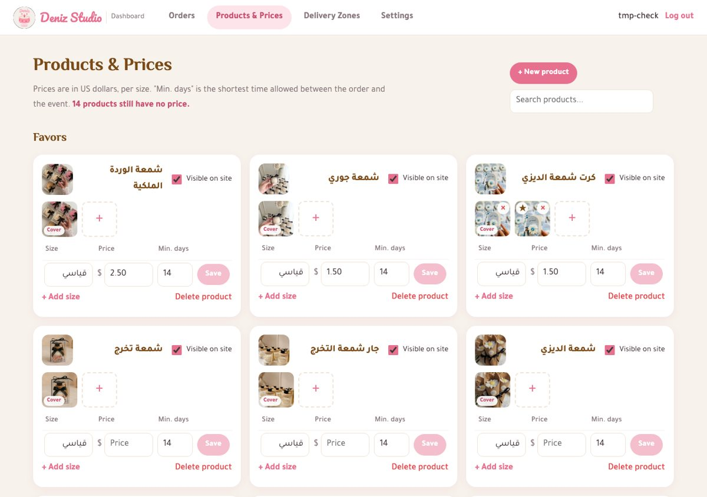
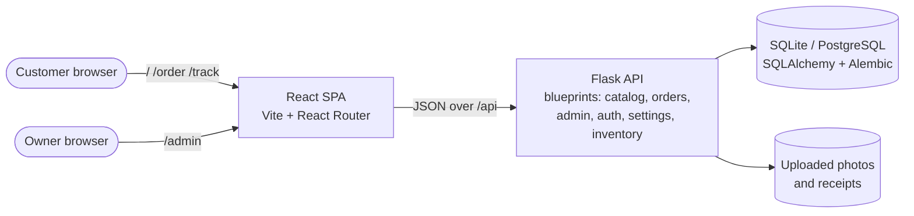

# Deniz Studio · Order Management System

[](https://github.com/sumaia-ahmad/deniz-candles/actions/workflows/ci.yml)

A full-stack system for **Deniz Studio**, my handmade scented-candle business in Damascus. Customers browse the
catalog and place made-to-order requests online; I review each order, track payments, and run the business from
a dashboard.

I built it to replace an Instagram-only workflow where order details got lost in messages, deadlines slipped,
customers kept asking about their orders, and there was no clear view of payments.

| Storefront (Arabic, RTL) | Order form | Dashboard (English) |
|---|---|---|
|  |  |  |

## Features

**Customer website (Arabic, right-to-left)**
- Catalog grouped into event favors (by occasion) and gifts, with photo galleries and prices in USD plus the
  Syrian pound equivalent
- Online order form: several pieces per order, each with size, quantity, colors and a custom name or phrase
- Event date limited by each piece's preparation time (14 days for favors, 3 for gifts, set per size)
- Damascus delivery zones with automatic fees, or shipping to other governorates
- Private tracking page per order: progress, totals, deposit, paid and remaining amounts
- Customers can upload their transfer receipt; it only counts once the admin confirms it

**Dashboard (English)**
- Orders arrive as *requests*: approve, reject with a reason, or propose a new date or changes, which the
  customer accepts or declines from the tracking page
- Week workload panel and a ready-to-copy Arabic message for every decision
- Payments: per-order deposit, transfers with receipts, cash held by the delivery driver until handed over,
  and verification of customer-uploaded receipts
- Soft business rules: confirming without the deposit or shipping an unpaid order shows a warning instead of
  blocking, so the owner keeps the final say
- Catalog management: new products, sizes, prices, preparation times, photos (cover, add, delete), visibility
- Inventory of raw materials with a stock ledger (every change is recorded with its reason), manual
  adjustments and low-stock alerts in the menu
- Purchases that add stock and keep a weighted average cost per material
- Recipes per size (what one piece is made of), giving the material cost and margin of every piece
- Starting to prepare an order takes its materials out of stock (with a warning if stock is short); cancelling
  puts them back
- Delivery zones, exchange rate and transfer details settings
- Admin and assistant roles; the assistant handles orders but cannot manage the catalog, prices, payments or settings

## Architecture



- **Monorepo** with `frontend/` (React + Vite) and `backend/` (Flask). In development Vite proxies `/api` to Flask,
  so the browser talks to a single origin.
- **Session-based authentication** with hashed passwords and role checks on every admin endpoint.
- **Schema changes go through migrations** (Flask-Migrate / Alembic), so real data is never wiped.

## Engineering decisions worth noting

- **Price snapshots:** each order item stores the product name, size and unit price at the time of ordering,
  so later catalog changes never alter past orders or invoices.
- **Money as `Numeric`, not float**, end to end; amounts travel as strings in the API to avoid rounding errors.
- **Prices live on sizes:** every product has at least one size, so a single place holds the price and the
  preparation time, and adding a size never needs a schema change.
- **Untrusted uploads are re-encoded:** images are verified, resized and re-saved as JPEG (which also strips
  metadata such as location), and receipts and reference images are only served to signed-in users.
- **Spam protection** on public forms with a honeypot field and a per-address rate limit.
- **Stock as a ledger:** quantities only change through recorded movements (purchase, order, return,
  adjustment), so every number can be traced back, and an order's materials are consumed exactly once.
- **Requirements first:** the [project specification](docs/project-spec.en.md) lists numbered functional
  requirements (FR-x) and business rules (BR-x) that the code and tests refer to.

## Tech stack

| Layer | Tools |
|---|---|
| Frontend | React 19, React Router, Vite, plain CSS (RTL-first), oxlint |
| Backend | Python 3.13, Flask, Flask-SQLAlchemy, Flask-Migrate (Alembic), Pillow |
| Database | SQLite in development, PostgreSQL in Docker |
| Deployment | Docker Compose: PostgreSQL, Flask on Gunicorn, Nginx serving the React build |
| Quality | pytest (80 tests), GitHub Actions CI (tests, migration checks, lint, build, full Docker stack smoke test) |

## Running it locally

**Requirements:** Python 3.13 and Node.js 22.

```bash
# Backend
cd backend
python3 -m venv .venv
source .venv/bin/activate
pip install -r requirements.txt
cp .env.example .env              # then set a long random SECRET_KEY
flask --app app db upgrade        # create the database
flask --app app seed              # load the starting catalog
flask --app app create-user deniz # create a dashboard account (asks for a password)
flask --app app run --debug       # http://localhost:5000

# Frontend (in a second terminal)
cd frontend
npm install
npm run dev                       # http://localhost:5173  ·  dashboard at /admin
```

On macOS, `start.command` at the project root does all of this in one double-click: it applies pending
migrations, asks for an account on first run, starts both servers and opens the dashboard.

### Running with Docker

The whole system runs as three containers: PostgreSQL, the Flask API on Gunicorn, and Nginx, which serves the
built website and forwards `/api` to the backend.

```bash
cp .env.example .env              # then set POSTGRES_PASSWORD and a long random SECRET_KEY
docker compose up -d --build      # migrations run automatically when the backend starts
docker compose exec backend flask --app app seed
docker compose exec backend flask --app app create-user deniz
```

Open http://localhost:8080 (dashboard at `/admin`). Database data and uploaded photos live in Docker volumes,
so they survive restarts and rebuilds.

### Tests

```bash
cd backend && source .venv/bin/activate && python -m pytest
```

The suite covers ordering rules (lead times, required fields, price snapshots, spam protection), the review
workflow, payments and deposits, inventory and costing, permissions, uploads and settings. CI runs it on every push, checks that the
migrations build a fresh database matching the models, and starts the full Docker stack on PostgreSQL to test
it end to end through Nginx.

## Project structure

```
backend/
  app/            Flask app: catalog, orders, admin, auth, settings, inventory, images, models
  migrations/     Alembic migrations
  tests/          pytest suite
  Dockerfile      API image (Gunicorn)
frontend/
  src/            storefront (App, pages/, components/) and dashboard (admin/)
  Dockerfile      website image (Nginx), with nginx.conf
docs/
  project-spec.en.md   requirements and business rules (Arabic version alongside)
compose.yaml      the full stack: PostgreSQL + API + website
start.command     one-click local start on macOS
```

## Roadmap

- Deploy online
- Order calendar and customer history pages
- Quote and invoice PDFs
- Expenses and monthly reports (sales, profit, top products)
- English version of the storefront
- Generating an order from a customer's Instagram message with an LLM

---

Built by **Sumaia Ahmad**.
